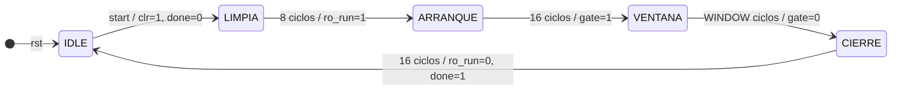
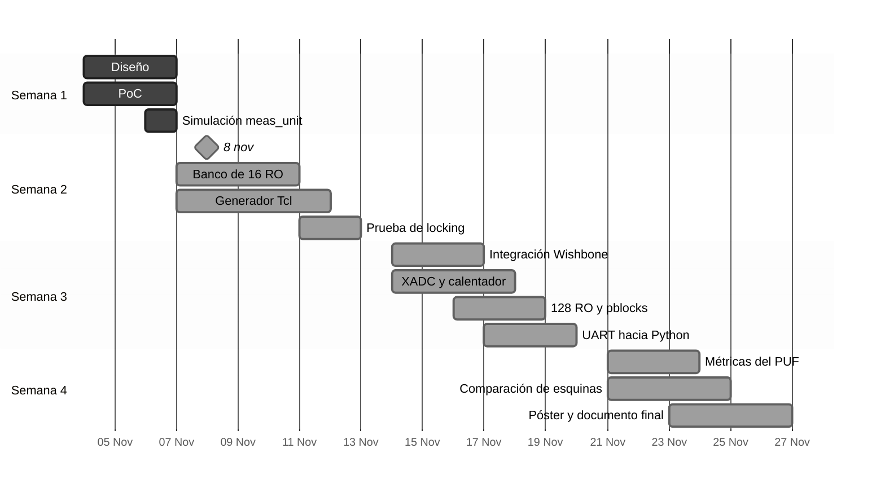

# RO-PUF
Ring-oscillator (RO) array on a Nexys A7 (Artix-7 XC7A100T) to measure real within-die delay variation and its temperature dependence, compare it against Vivado’s Slow/Fast timing corners, and evaluate a 64-bit RO-PUF. Verilog hardware, C firmware on RVfpga (SweRV EH1), Python analysis. UCR IE-0424.

# Primer avance

## III. Definición de módulos de hardware y firmware

### A. Módulos de hardware

El RTL nuevo se ubica en `../src/SweRVolfSoC/Peripherals/pvt/`, junto a los
demás periféricos del SoC. La Tabla II define cada módulo.

**Tabla II. Módulos de hardware**

| Módulo | Función |
|---|---|
| `ring_osc` | Un RO de 5 etapas con primitivas instanciadas: `LUT2` NAND (`INIT = 4'h7`) y cuatro `LUT1` inversores (`INIT = 2'b01`), con `DONT_TOUCH` en celdas y redes. Con `en = 0` la salida de la NAND queda en 1 y el anillo se detiene. Con `` `ifdef SIM `` se reemplaza por un reloj de semiperiodo conocido. |
| `meas_unit` | Máquina de estados de la ventana y dos canales (`meas_chan`), cada uno con preescalador ÷2, `BUFG`, sincronizador de 2 flip-flops para la compuerta y contador de 32 bits con borrado asíncrono. |
| `ro_standalone_top` | Módulo de nivel superior del modo autónomo con el reloj de 100 MHz de la tarjeta, sin CPU ni XADC. En la PoC tiene un RO y muestra la cuenta en hexadecimal en el display; tendrá su propio proyecto bajo `../vivado/`. |
| `ro_bank` | `N_RO` instancias de `ring_osc` en un `generate`, con nombres jerárquicos fijos `g_ro[i].u_ro` de los que depende el generador Tcl de ubicación. |
| `ro_selector` | Habilita solo el RO elegido (modo single) o el par elegido (modo pair) mientras `ro_run = 1` y lleva sus salidas a los canales A y B. En modo single el canal B no recibe reloj y `COUNT_B` queda en 0. |
| `xadc_reader` | Instancia la primitiva XADC y lee por DRP la temperatura (`DADDR` 0x00) y VCCINT (0x01). Conserva el código de 12 bits ubicado en `DO[15:4]`. |
| `heater` | Banco de `N_HEAT` flip-flops que conmutan con `clk_core` mientras `en = 1`. `N_HEAT` se definirá según el aumento de temperatura observado. |
| `pvt_wb_slave` | Decodifica los registros, responde en Wishbone e instancia los bloques anteriores. |

La máquina de estados de `meas_unit` se muestra en la Fig. 5 y su
temporización en la Fig. 4. Respecto de la propuesta inicial se agregó el
estado `LIMPIA`, que mantiene el borrado activo durante 4 ciclos y lo libera
4 ciclos antes de que `ro_run` suba. Así el primer flanco del RO no puede
violar el tiempo de recuperación del borrado asíncrono. Las esperas de
`ARRANQUE` y `CIERRE` duran 16 ciclos cada una y son parámetros del módulo.

*Fig. 5. Máquina de estados de `meas_unit`. `busy` vale 1 en todo estado
distinto de IDLE. En LIMPIA, `clr` vale 1 solo en los primeros 4 ciclos.*

La ventana se genera en `clk_core`, pero los contadores funcionan en el
dominio del RO. La señal `gate` pasa por dos flip-flops sincronizadores
(`ASYNC_REG`) en ese dominio, porque una compuerta metaestable podría
incrementar solo algunos bits del contador. Ambos flancos se retrasan por
igual, así que la duración de la ventana se conserva con un error cercano a
±1 cuenta. Los contadores se limpian de forma asíncrona, ya que el RO está
detenido y no hay reloj en ese momento. Se leen en `clk_core` únicamente con
`DONE` = 1, cuando el RO ya está detenido y sus valores no cambian.

### B. Cambios en el RVfpga existente

La Tabla III resume los cambios en los archivos de `../src/`. El núcleo SweRV
EH1 no se modifica.

**Tabla III. Cambios en el RVfpga existente**

| Archivo en `../src/` | Cambio |
|---|---|
| `SweRVolfSoC/Interconnect/WishboneInterconnect/wb_intercon.v` | `num_slaves` de 11 a 12, nueva entrada en `MATCH_ADDR` (`32'h00001C00`) y `MATCH_MASK` (`32'hffffffc0`), puertos `wb_pvt_*` y extensión de los vectores `wbs_*` en el mismo orden. |
| `SweRVolfSoC/Interconnect/WishboneInterconnect/wb_intercon.vh` | Cables `wb_m2s_pvt_*` y `wb_s2m_pvt_*`. |
| `SweRVolfSoC/swervolf_core.v` | Instancia de `pvt_wb_slave`. |
| `rvfpganexys.xdc` | Restricciones de la PoC: ubicación del anillo, lazo permitido, relojes del RO y rutas falsas (ya agregadas). |
| `SweRVolfSoC/SweRVEh1CoreComplex/` | Ninguno. |

### C. Restricciones físicas

Para el banco de RO, las restricciones se generarán con Tcl en
`constraints/`, a partir de un CSV de sitios exportado de Vivado, omitiendo
las columnas de BRAM y DSP y la espina central de reloj.

### E. Módulos de firmware y software

El firmware se ubicará en `fw/` como proyecto PlatformIO con el entorno
`swervolf_nexys`, tomando como base `../Project/platformio.ini` y las rutinas
de UART de `../Project/UARTFunc.c`. En la PC, los módulos estarán en `py/` y
usarán `pyserial`, `numpy` y `matplotlib`.

**Tabla IV. Módulos de firmware (C) y de la PC (Python)**

| Módulo | Función |
|---|---|
| ***Firmware*** | |
| `pvt_hal` | Definiciones de registros y acceso de 32 bits; `pvt_measure()` configura, inicia, espera `DONE` y lee los resultados. |
| `pvt_scan` | Recorre los RO $R$ veces y calcula el promedio. |
| `pvt_puf` | Calcula los 64 bits del PUF a partir de los pares de cada región. |
| `pvt_heater` | Enciende y apaga el calentador según el experimento. |
| `uart_stream` | Da formato a cada medición en una línea `M,...` y la transmite. |
| `main` | Selecciona y ejecuta el experimento. |
| ***PC*** | |
| `logger.py` | Guarda las líneas sin modificar en `data/<fecha>_<ID>.*`, junto con los metadatos del experimento. |
| `parser.py` | Valida y convierte el formato UART; se mantiene sincronizado con `uart_stream`. |
| `analysis.py` | Genera mapas de calor, histogramas y curvas $f$ contra $T$ en `doc/figs/`. Nunca modifica los datos crudos. |
| `puf_metrics.py` | Calcula la confiabilidad y la uniformidad. |

## IV. Interfaces entre componentes

### A. Mapa de registros

La dirección base es `0x80001C00`. Se usan accesos de 32 bits, y los offsets
0x20 a 0x3C leen 0. La Tabla V propone los campos de bits. Con `BUSY` = 1 se
ignoran `START` y las escrituras a `SEL`, `WINDOW` y `MODE`, mientras que
`HEATER_EN` sí puede cambiar. Una misma escritura a `CTRL` debe incluir
`MODE` y `HEATER_EN` junto con `START`, para no alterarlos.

**Tabla V. Mapa de registros de `pvt_wb_slave` (base `0x80001C00`)**

| Offset | Registro | Acceso | Bits | Descripción |
|---|---|---|---|---|
| 0x00 | `CTRL` | L/E | 0 `START`, 1 `MODE`, 2 `HEATER_EN` | `START` se autolimpia y lee 0. `MODE`: 0 single, 1 pair. |
| 0x04 | `SEL` | L/E | [6:0] `RO_A`, [14:8] `RO_B` | Índices de los RO. |
| 0x08 | `WINDOW` | L/E | [31:0] | Duración en ciclos del reloj de referencia. |
| 0x0C | `STATUS` | L | 0 `BUSY`, 1 `DONE` | `DONE` se mantiene hasta el siguiente `START`. |
| 0x10 | `COUNT_A` | L | [31:0] | Cuenta del canal A, tras el ÷2. |
| 0x14 | `COUNT_B` | L | [31:0] | Cuenta del canal B, tras el ÷2. |
| 0x18 | `TEMP` | L | [11:0] | Código de temperatura del XADC. |
| 0x1C | `VCCINT` | L | [11:0] | Código de VCCINT del XADC. |

Las magnitudes físicas se obtienen con

$$
f_\text{RO} = \frac{P \cdot \text{count} \cdot f_\text{ref}}{\text{WINDOW}} \tag{1}
$$

$$
T\,[^\circ\text{C}] = \frac{\text{code} \cdot 503{,}975}{4096} - 273{,}15 \tag{2}
$$

$$
V_\text{CCINT}\,[\text{V}] = \frac{\text{code} \cdot 3}{4096} \tag{3}
$$

donde $P = 2$ es el factor del preescalador y $f_\text{ref}$ vale 50 MHz en el
SoC y 100 MHz en el modo autónomo. Las dos últimas expresiones son las
funciones de transferencia del XADC [4].

### B. Puertos internos

La Tabla VI lista los puertos de cada módulo. 

**Tabla VI. Puertos de los módulos de hardware**

| Módulo | Entradas | Salidas |
|---|---|---|
| `ring_osc` | `en` | `out` |
| `ro_bank` | `en[N_RO-1:0]` | `ro_out[N_RO-1:0]` |
| `ro_selector` | `ro_run`, `mode`, `sel_a[6:0]`, `sel_b[6:0]`, `ro_out[N_RO-1:0]` | `ro_en[N_RO-1:0]`, `ro_clk_a`, `ro_clk_b` |
| `meas_unit` | `clk`, `rst`, `start`, `window[31:0]`, `ro_clk_a`, `ro_clk_b` | `ro_run`, `busy`, `done`, `count_a[31:0]`, `count_b[31:0]` |
| `xadc_reader` | `clk`, `rst` | `temp_code[11:0]`, `vcc_code[11:0]` |
| `heater` | `clk`, `rst`, `en` | ninguna |
| `pvt_wb_slave` | `i_clk`, `i_rst`, `i_wb_adr[5:0]`, `i_wb_dat[31:0]`, `i_wb_sel[3:0]`, `i_wb_we`, `i_wb_cyc`, `i_wb_stb` | `o_wb_rdt[31:0]`, `o_wb_ack`, `o_wb_err` |
| `ro_standalone_top` (PoC) | `clk`, `rstn`, `i_sw[1:0]` | `o_led[2:0]`, `AN[7:0]`, `CA` a `CG` |

### E. Numeración de los RO y bits del PUF

Cada RO se identifica como $i = 2(8\,\text{fila} + \text{columna}) + k$, con
$k \in \{0, 1\}$ dentro de la región. El bit de cada región se obtiene de sus
dos RO, $i$ par e $i+1$, y vale 1 si la cuenta de $i$ es mayor que la de
$i+1$. Las 64 regiones producen los $n = 64$ bits. Según [2], la
confiabilidad se calcula como

$$
C = 100\% - \frac{1}{m}\sum_{t=1}^{m}\frac{\mathrm{HD}(R_\text{ref}, R_t)}{n}\cdot 100\% \tag{4}
$$

donde $R_\text{ref}$ es la respuesta de referencia y $R_t$ son $m$ respuestas
posteriores; su valor ideal es 100 %. La uniformidad es la fracción de unos
en la respuesta y su valor ideal es 50 %.

## V. Cronograma de trabajo actualizado

**Tabla VIII. Entregas y estado al 8 de noviembre de 2026**

| Entrega | Contenido | Estado |
|---|---|---|
| Vie 6 nov | Diseño detallado. Prueba de concepto (PoC): 1 RO y contador en el display de 7 segmentos; primera frecuencia medida; decisión sobre ÷2 y número de etapas. | PoC completada (396,15 MHz). |
| Vie 13 nov | Banco de 16 RO y `meas_unit` en modo autónomo; simulación y validación; generador Tcl de ubicación; prueba de amarre (locking). | En curso: `meas_unit` implementado y simulado. |
| Vie 20 nov | Integración Wishbone, XADC, calentador y 128 RO; UART hacia Python; primer mapa de calor y primera curva $f$ contra $T$; decisión de pblocks. | Pendiente |
| Vie 27 nov | Métricas del PUF, comparación con esquinas Slow/Fast, borradores del póster y del documento final. | Pendiente |

*Fig. 6. Cronograma hasta la entrega final.*

## Referencias

1. Imagination Technologies, "RVfpga: Understanding computer architecture,"
   Imagination University Programme.
2. A. Maiti, V. Gunreddy y P. Schaumont, "A systematic method to evaluate and
   compare the performance of physical unclonable functions," en *Embedded
   Systems Design with FPGAs*, P. Athanas, D. Pnevmatikatos y N. Sklavos,
   Eds. Nueva York, NY, EE. UU.: Springer, 2013, pp. 245–267.
3. Xilinx, *7 Series FPGAs Configurable Logic Block User Guide*, UG474.
4. Xilinx, *7 Series FPGAs and Zynq-7000 SoC XADC Dual 12-Bit 1 MSPS
   Analog-to-Digital Converter User Guide*, UG480.
